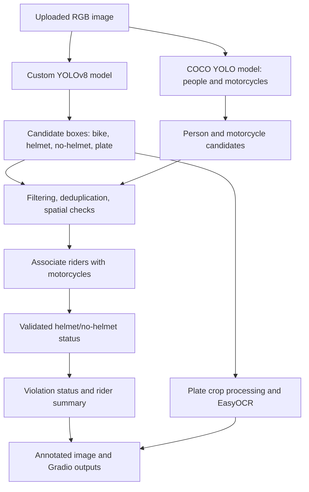

# Architecture

## Inference flow

The primary decision is based on validated `no-helmet` detections associated with motorcycle occupants. A missing `helmet` prediction alone does not trigger a violation. The COCO model and association stages provide context for validation; internal person boxes are not part of the final public annotation.

## Package map

| Path | Responsibility |
| --- | --- |
| `app/` | Gradio entry point, interface components/styles, display formatting. |
| `config/` | Project-relative model paths, class IDs/names, settings, and thresholds. |
| `src/core/` | End-to-end inference orchestration and result records. |
| `src/models/` | Custom and COCO model adapters and model loading. |
| `src/detection/` | Candidate filtering and second-pass detection helpers. |
| `src/postprocess/` | Confidence filtering, class-aware NMS, duplicate removal, class conflict selection. |
| `src/association/` | Person-to-motorcycle and spatial matching. |
| `src/ocr/` | Plate preprocessing, candidate scoring, parsing, and EasyOCR calls. |
| `src/visualization/` | Bounding-box rendering and HTML detection summary. |
| `src/evaluation/` | Metric and error-analysis utilities. |
| `scripts/` | Validation, evaluation, benchmarking, and one-image command-line entry points. |
| `tests/` | Model-independent unit tests for core helpers. |

## Model weights

The app loads the fine-tuned custom checkpoint and a COCO-pretrained YOLOv8 model. The earlier custom checkpoint is retained as the baseline/archive. Their repository paths and roles are documented in [`checkpoints/README.md`](../checkpoints/README.md). Weight path constants are in `config/paths.py`.

## Extension boundaries

The web entry point is `app/app.py`, which delegates to `src/core/pipeline.py`. Dataset YAML files are supplied to evaluation scripts; the runtime model paths do not depend on a local training dataset. See [`docs/demo.md`](demo.md) for the application flow and [`docs/dataset.md`](dataset.md) for dataset handling.
